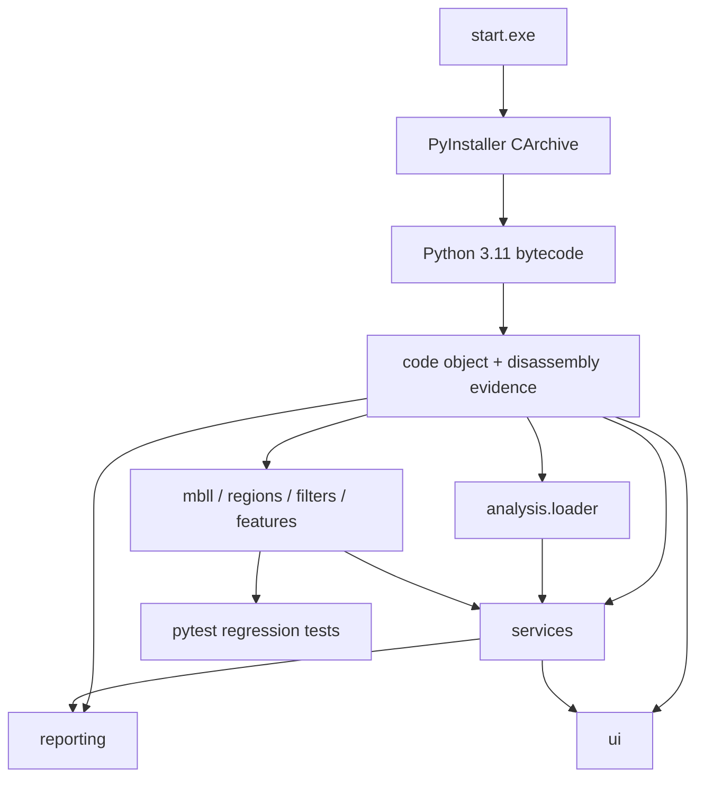

# start.exe 逆向與模組化重建報告

> 分析日期：2026-08-25
> 報告選型：一般逆向工程，`flavor = null`
> 目標：在不修改原檔的前提下，建立可測試、可擴充的 GitHub 原始碼專案

## 執行摘要

`start.exe` 是 64 位 Windows PE，但業務程式不是原生 C/C++，而是 Python 3.11 + PyQt5 的 PyInstaller 單檔封裝。離線解包確認 archive 未加密，主入口為 `start`，自有程式集中於 `controller.pyc`、兩個 Qt UI 模組與版本模組。逐 code object 還原取得控制器 66 個函式中的 64 個可讀片段，另兩個以完整 Python 3.11 反組譯重建；核心 NIRS 載入、inverse MBLL、ROI、濾波、積分、重心及 DOCX 報告路徑已拆分成獨立模組。原始程式的雜湊在分析前後保持一致，分析與下載工具均位於被 Git 排除的隔離目錄。

## 範圍與授權

- Scope：[scope.md](../work/start-exe-reconstruction/scope.md)
- 授權：`granted`，owner-operated local file
- 網路設定：樣本分析為 `offline`；僅為下載公開逆向工具與 Python 執行環境使用網路
- 範圍內：`start.exe` 靜態分析、封裝解包、Python bytecode 還原、模組化重建、測試與文件
- 範圍外：修改或覆寫原始 `start.exe`、處理既有病患報告內容、把分析樣本推送到公開服務

## 目標資訊

| 屬性 | 值 |
|---|---|
| 檔名 | `start.exe` |
| 大小 | 146,882,304 bytes |
| SHA-256 | `07BF779354C1D8C4279649A75E90325392DAA8A0EA5AD539E3B01BD3573267C8` |
| 格式 | PE32+ x64 |
| 入口 RVA | `0xB310` |
| 封裝 | PyInstaller，Python 3.11 |
| Python 入口 | `start` |
| 封裝加密 | 否 |

## 靜態分析

### PE 與導入表

原生 PE 有 7 個標準區段，檔案尾端有 146,604,800 bytes overlay，與 PyInstaller CArchive 一致。導入表依賴 `USER32.dll`、`COMCTL32.dll`、`KERNEL32.dll`、`ADVAPI32.dll` 與 `GDI32.dll`；其中視窗、檔案、動態載入及 runtime API 符合 PyInstaller bootloader。這張 IAT 只描述 bootloader，因此 Python 模組與 import 名稱被當作等價業務依賴錨點一併記錄。

Python 業務依賴包括 PyQt5、NumPy、pandas、SciPy、Matplotlib、python-docx、openpyxl 與 xlsxwriter。未觀察到網路 client 套件或業務 URL；這是靜態觀察，不等同於對所有執行期能力的否定。

### 自有模組

| 模組 | 作用 | SHA-256 / 證據 |
|---|---|---|
| `start.pyc` | Qt application 與主視窗入口 | `F5E4E9B4…EEE39` |
| `controller.pyc` | 設定、分析、繪圖、DOCX 與 UI controller | `046B3055…5AB1` |
| `UI.pyc` | 主視窗的 pyuic 生成程式 | `8306353F…5C91` |
| `report_setting_dialog_UI.pyc` | 報告設定對話框 | `E4999471…EC77` |
| `version.pyc` | `v1.0.17 (260401)` | E-004 |

### 核心演算法

1. 760 nm DPF = `6.0`，850 nm DPF = `5.2`，其他波長 fallback = `5.5`。
2. inverse MBLL 使用消光係數矩陣 `[[0.147, 3.396], [0.586, 1.790]]`，路徑長為 DPF × 30 mm，結果由 mM 乘 1000 轉為 µM。
3. ROI 通道分組為右額 1–4、中額 5–11、左額 12–15；側額為左右兩區的平均。
4. 舊版 `HbO`/`HbR` workbook 流程套用 `×1000` 尺度；新版 `Filtered ΔHb` 或 `Padded ΔHb` 先做 MBLL。
5. 特徵為作業區間正值面積積分，以及從 task start 到 measure end 的累積面積 50% 重心。
6. mean/median filter 使用端點複製 padding，並要求正奇數視窗。

## 重建架構



原版約 1,200 行業務邏輯集中在 `MainWindow_controller`。重建版把 UI 與數值核心隔離，並以 `nirs_report.plugins` entry point 提供選配功能入口；新演算法可先以純函式與測試加入，不需修改視窗類別。

## 動態分析

本次沒有執行原始 `start.exe` 或把病患資料載入隔離分析環境，原因是使用者要求保留原始程式且現有 `report/` 屬於使用者資料。動態 UI 與 golden-master 報告比對因此不作「validated 等價」宣稱；核心結論由封裝 metadata、Python 3.11 code object、反組譯與重建測試交叉支撐。

## Evidence

| E-id | 內容 | source_ref | hash |
|---|---|---|---|
| E-001 | PE 身分、大小、入口與樣本雜湊 | `work/.../evidence/E-001.md` | `07BF7793…267C8` |
| E-002 | 原生 PE 導入表分類 | `work/.../evidence/E-002.md` | 樣本 SHA-256 |
| E-003 | PyInstaller/Python 3.11/CArchive 資訊 | `work/.../evidence/E-003.md` | 樣本 SHA-256 |
| E-004 | 自有 Python 模組、code object 與還原覆蓋 | `work/.../evidence/E-004.md` | 模組雜湊見證據 |
| E-005 | PyLingual 大型 controller 第二意見達時間盒、未產出 | `work/.../evidence/E-005.md` | n/a |

## Findings

### F-001

- title: 目標是未加密的 Python 3.11 PyInstaller 應用
- severity: n/a_re
- category: reverse_algo
- status: validated
- evidence_ids: [E-001, E-003, E-004]
- confidence: high
- location: `start.exe` CArchive / `start.pyc`
- impact: 可由 bytecode 與封裝 metadata 重建高階模組，不需只依賴原生機器碼推測
- remediation: n/a

### F-002

- title: 原始架構把分析、UI、繪圖與報告集中在單一控制器
- severity: n/a_re
- category: design
- status: validated
- evidence_ids: [E-004]
- confidence: medium
- location: `controller.pyc:MainWindow_controller`
- impact: 修改任一功能容易牽動 UI 與報告；單元測試困難
- remediation: 以純分析模組、服務層、報告層、UI 層與 plugin entry point 解耦
- residual_risk: 單一主要靜態證據，已保留完整 code-object manifest 供人工覆核

### F-003

- title: 核心 NIRS 數學與新舊 Excel 分支已恢復
- severity: n/a_re
- category: reverse_algo
- status: candidate
- evidence_ids: [E-004]
- confidence: medium
- location: `analysis/*.py`
- impact: 可建立自動測試與新分析功能，但臨床等價仍需已知樣本比對
- remediation: 以去識別化 golden-master workbook 對原版與重建版逐欄驗證

## Path

### P-001

- title: 從封裝執行檔到模組化專案
- path_type: solve
- start: `start.exe`
- goal: 可測試、可擴充的 Python GitHub 專案
- steps:
  1. action: 固定樣本 SHA-256 與 PE 身分 — evidence: E-001 — finding: F-001
  2. action: 分類原生 imports，辨識 bootloader 邊界 — evidence: E-002 — finding: F-001
  3. action: 定位 PyInstaller cookie 並解包 CArchive/PYZ — evidence: E-003 — finding: F-001
  4. action: 枚舉自有 Python code objects 並逐函式還原 — evidence: E-004 — finding: F-002
  5. action: 依責任重組 loader/core/service/report/UI/plugin — evidence: E-004 — finding: F-003
- residual_risks: 圖表像素與 DOCX 樣式尚未以去識別化真實樣本做 golden-master 驗證

## 復現

```powershell
# 在專案根目錄建立開發環境
python -m venv .venv
.\.venv\Scripts\python -m pip install -e ".[dev]"
.\.venv\Scripts\python -m pytest -q

# 啟動重建版
.\.venv\Scripts\python -m nirs_report_app
```

逆向用的大型工具、模型、原始樣本副本與解包內容位於 `.gitignore` 排除路徑；報告的 case-local `work/` 也預設不推送 GitHub，若需稽核可另外封存。

## 驗證界線與建議

- 高信心：封裝類型、Python 版本、入口、自有模組、主要依賴與核心常數。
- 中信心：由 code object 還原的控制流程與模組邊界。
- 待業務驗收：完整舊版 DOCX 排版、所有 Matplotlib 圖像細節、真實儀器 workbook 的欄位變體。
- PyLingual 已成功載入本機 Python 3.11 模型，但大型 controller 在時間盒內未產出；其結果未用於 Findings。
- 推送公開 GitHub 前必須確認原程式、圖片、商標與演算法的發布權，並由擁有者選擇 LICENSE。

## Timeline 摘要

1. 建立離線 case scope，`ready_for_act=true`。
2. 固定原檔與分析副本 SHA-256，兩者一致。
3. 完成 PyInstaller archive info 與 PE imports 硬門。
4. 解包 1,243 個 CArchive 與 2,121 個 PYZ 項目。
5. 確認 5 個自有 Python 模組並完成逐 code-object 還原。
6. 建立 `src/` 模組、測試、CI、README、架構與本報告。
