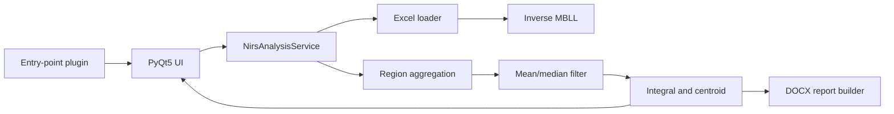

# 架構與擴充方式

## 資料流

UI 不直接進行數值分析；`analysis/` 也不匯入 PyQt5。這條邊界讓核心演算法可在 CI、批次程式或未來 Web API 中重用。

## 模組責任

| 模組 | 責任 | 可替換點 |
|---|---|---|
| `analysis.loader` | 辨識新舊 Excel 工作表、建立時間軸 | 新儀器格式 adapter |
| `analysis.mbll` | DPF 與 inverse MBLL | 波長、距離、消光係數策略 |
| `analysis.regions` | 通道映射與 ROI 平均 | 可設定 montage |
| `analysis.filters` | 邊界延伸的 mean/median filter | 新濾波器 |
| `analysis.features` | 正值積分與累積面積重心 | 新 biomarker |
| `services` | 將純函式組成分析 use case | 背景工作、批次分析 |
| `reporting` | 建立 DOCX | 報告模板或 PDF exporter |
| `ui` | 檔案選擇、參數輸入、結果顯示 | 新 Qt 頁面 |

## 建議的功能開發流程

1. 在 `analysis/` 新增不依賴 UI 的函式與型別。
2. 先為正常值、邊界值與錯誤輸入建立測試。
3. 在 `NirsAnalysisService` 注入或編排新功能。
4. 最後才新增 Qt 控制項，避免演算法綁死視窗。
5. 若是選配功能，使用 `nirs_report.plugins` entry point，不修改核心入口。

## 相容性基準

重建依據包括：Python 3.11 bytecode、PyInstaller archive、64 個成功逐函式還原片段，以及 2 個完整反組譯片段。較高風險區域是圖表排版與完整舊版 DOCX 樣式；這些應以真實去識別化樣本做 golden-master 比對。
